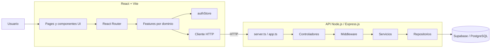
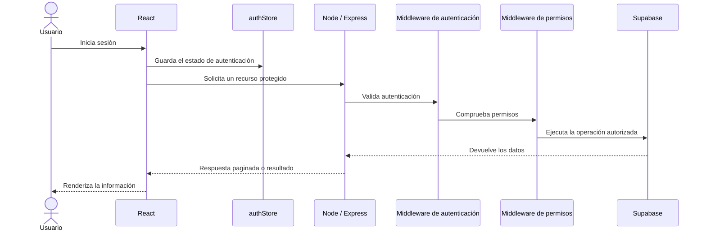

# ERP Multimadera

> Plataforma web para la gestión integral de clientes, empleados, materiales, pedidos y usuarios.

ERP Multimadera es una solución empresarial compuesta por un frontend web y una API backend independientes. La aplicación está diseñada para centralizar procesos operativos y mantener separadas las responsabilidades de presentación, negocio y persistencia.

## Funcionalidades principales

- Gestión de clientes.
- Gestión de empleados.
- Gestión de materiales.
- Gestión de pedidos.
- Administración de usuarios y permisos.
- Reportería para la consulta de información empresarial.
- Autenticación y autorización para proteger los recursos.
- Respuestas paginadas para facilitar el consumo de grandes volúmenes de información.

## Arquitectura y tecnologias

> Las tecnologías se muestran con badges SVG enlazados a su documentación oficial.

### Frontend

  
  
  
  

### Backend

  
  
  
  
  
  
  

### Persistencia y despliegue

  
  
  
  
  

## Arquitectura general

El frontend y el backend evolucionan como aplicaciones independientes. La SPA de React consume la API de Node.js mediante un cliente HTTP. El backend concentra las reglas de negocio y controla el acceso a la persistencia.

## Arquitectura del backend

La API está organizada en capas con responsabilidades diferenciadas:

- **Controladores:** reciben las solicitudes HTTP y construyen las respuestas.
- **Middleware:** valida autenticación, permisos y otras preocupaciones transversales.
- **Servicios:** contienen los casos de uso y las reglas de negocio.
- **Contratos de repositorio:** desacoplan la lógica de negocio de la tecnología de persistencia.
- **Repositorios de Supabase:** implementan el acceso concreto a PostgreSQL.
- **DTOs:** definen y validan los contratos de entrada y salida de la API.

### Flujo de una petición

```mermaid
%%{init: {
  "flowchart": {
    "htmlLabels": false,
    "nodeSpacing": 8,
    "rankSpacing": 12,
    "padding": 6,
    "useMaxWidth": true
  },
  "themeVariables": {
    "fontSize": "10px"
  }
}}%%

flowchart LR
    CLIENT[React]
    SERVER[server.ts]
    APP[app.ts]
    CONTROLLER[Controladores]
    AUTH[Auth Middleware]
    PERM[Permisos Middleware]
    SERVICE[Servicios]
    CONTRACT[Contratos Repo]
    SUPABASE[Repos Supabase]
    DB[(PostgreSQL)]

    CLIENT -->|HTTP Req| SERVER
    SERVER --> APP --> CONTROLLER --> AUTH --> PERM --> SERVICE --> CONTRACT --> SUPABASE --> DB
    DB --> SUPABASE --> SERVICE --> CONTROLLER
    CONTROLLER -->|HTTP Res| CLIENT
```

## Arquitectura del frontend

La interfaz utiliza React con Vite, Tailwind CSS y organiza el código por funcionalidades de negocio. Cada funcionalidad agrupa sus componentes, modelos y servicios, mientras que las piezas compartidas se mantienen en módulos reutilizables.

```mermaid
flowchart LR
    MAIN[main.tsx]
    APP[App.tsx]
    ROUTES[Rutas de la aplicación]
    LAYOUT[Layout protegido]
    FEATURE[Feature de negocio]
    SERVICE[Servicios de la feature]
    CLIENT[Cliente HTTP]
    API[API Multimadera]

    MAIN --> APP
    APP --> ROUTES
    ROUTES --> LAYOUT
    LAYOUT --> FEATURE
    FEATURE --> SERVICE
    SERVICE --> CLIENT
    CLIENT -->|HTTP| API
```

Las funcionalidades principales se organizan alrededor de los siguientes dominios:

- `clientes`
- `empleados`
- `materiales`
- `pedidos`
- `usuarios`
- `reporteria`

## Seguridad y autorización

La seguridad se implementa en dos niveles:

- En el frontend, `ProtectedRoutes`, `ProtectedLayout`, `authStore` y `usePermisos` controlan la navegación y la visibilidad de elementos de la interfaz.
- En el backend, los middleware de autenticación y permisos realizan la validación definitiva antes de ejecutar operaciones protegidas.

La protección del frontend mejora la experiencia de usuario, pero no sustituye la autorización del backend. Las reglas de acceso deben validarse siempre en la API antes de consultar o modificar información.

## Decisiones arquitectónicas

- **Separación de aplicaciones:** frontend y backend pueden evolucionar y desplegarse de forma independiente.
- **Arquitectura por funcionalidades:** cada módulo de negocio mantiene sus componentes, modelos y servicios relacionados.
- **Separación de responsabilidades:** controladores, servicios y repositorios tienen responsabilidades claras.
- **Inversión del acceso a datos:** los servicios dependen de contratos, mientras que Supabase queda aislado en la infraestructura.
- **Middleware transversal:** autenticación y permisos se gestionan fuera de los controladores.
- **DTOs y paginación:** favorecen contratos consistentes y respuestas adecuadas para el frontend.
- **Documentación de API:** Swagger / OpenAPI facilita consultar y mantener los endpoints documentados.
- **Contenerización:** Docker y Docker Compose simplifican los flujos de desarrollo y ejecución del backend.
- **Despliegue flexible:** Vercel y Render permiten desplegar de forma independiente el frontend y la API según las necesidades del proyecto.

## Estado del proyecto

El proyecto se encuentra estructurado como una solución modular orientada a la gestión empresarial. Las funcionalidades, enlaces de despliegue y comandos de ejecución deben mantenerse sincronizados con la implementación actual.

## Sobre este repositorio

Este README presenta la arquitectura y las decisiones técnicas de ERP Multimadera. Para una revisión técnica completa, se requiere autorización por cuestiones de seguridad basadas en la tríada CIA: confidencialidad, integridad y disponibilidad.
