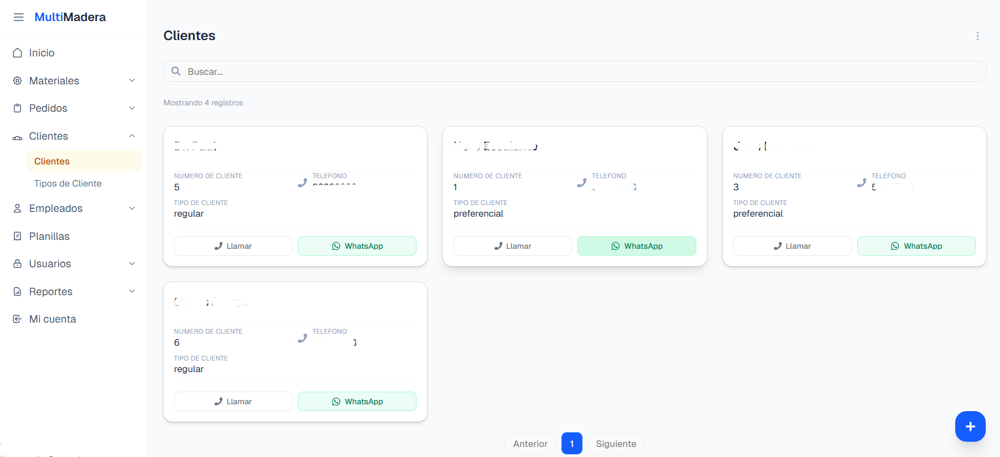
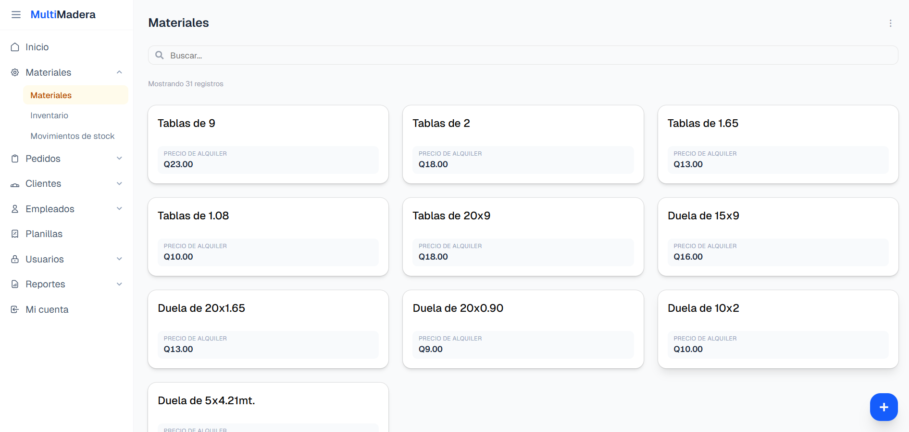
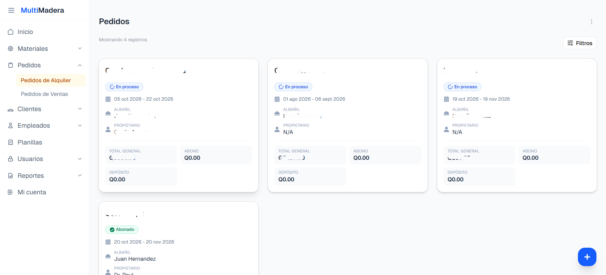
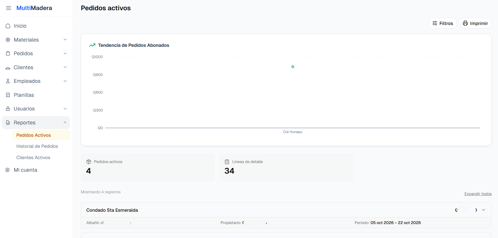
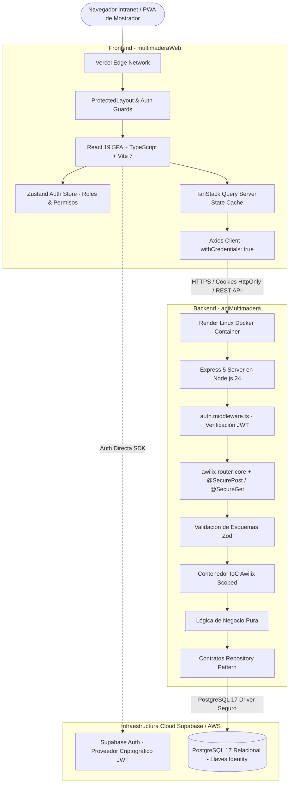

# Sistema Multimadera 


[](https://multimadera-web.vercel.app)
[](https://github.com)
[](https://github.com)
[](https://supabase.com)
[](https://docker.com)

> **Intranet de Gestión Operativa y Administrativa (ERP Interno)** desarrollada a la medida para un alquiler de herramientas para construccion (Escuintla, Guatemala). La plataforma centraliza el flujo de mostrador para el alquiler de herramientas auxiliares de construcción, sustituyendo los registros manuales en cuadernos por un entorno web seguro con **Control de Acceso Basado en Roles (RBAC)**, reduciendo en más del **80% el tiempo de despacho**, garantizando **trazabilidad del 100% de herramientas en obras activas** y asegurando **cero errores de cálculo en subtotales y totales**.

---

## en Producción
* **Aplicación Web React (Vercel)** 
* **API REST Node/express (Render):** Contenedor Docker Linux multi-stage con SSL/TLS continuo.
* **Base de Datos & Auth:** PostgreSQL 17 administrado en Supabase.

---

## Contexto Operativo

Antes de la implementación del sistema, el negocio operaba bajo registros manuscritos en libretas de papel, lo que generaba inconsistencias:

| Proceso en Papel | Reto Operativo Identificado | Solución Implementada en el Sistema |
| :--- | :--- | :--- |
| **Lentitud en Mostrador** | 12 a 15 minutos redactando notas a mano para pedidos grandes. | Formulario web reactivo que reduce el tiempo a **menos de 2 minutos**. |
| **Pérdida de Trazabilidad** | Herramientas en obra sin responsable, fechas ni dirección clara. | Captura obligatoria de **dirección de obra, fechas, albañil y propietario**. |
| **Riesgo en Sumatorias Manuales** | Multiplicaciones y sumas manuales con calculadora en cada renglón. | **100% de exactitud matemática:** Cálculo automático de subtotales y totales. |
| **Vulnerabilidad de Datos** | Cuadernos abiertos sobre el mostrador al alcance de cualquier visitante. | **Seguridad RBAC:** Control de acceso por roles con JWT y cookies *HttpOnly*. |

---

## Módulos Principales del Sistema

### 1. Módulo de Clientes (Padrón Indexado)
Cuenta con buscador reactivo por nombre o teléfono en menos de 5 segundos y botones de contacto directo para llamadas y WhatsApp.



---

### 2. Módulo de Materiales (Catálogo Técnico)
Estandariza las especificaciones técnicas de las herramientas auxiliares de madera y metal: tablas, tendales de varias medidas, duelas, parales y triquez metálicos, inventario con stock y movimientos de stock.



---

### 3. Módulo de Pedidos (Núcleo Operativo)
Núcleo del alquiler: asignación obligatoria de obra, fechas de inicio y devolución, y albañil responsable. Genera **cero errores en el cálculo automático de subtotales y totales**. Permite auditar en tiempo real los pedidos activos en campo (evidenciado con 4 obras simultáneas y 34 líneas de detalle en seguimiento).




---

### 4. ⚙️ Módulos de Soporte Administrativo
* **Empleados:** Registro del personal y ciclo de vida laboral; base estructural para la asignación de cuentas de usuario.
* **Planillas:** Componente administrativo para la gestión y control de las semanas de pago del personal del negocio.
* **Usuarios y Roles (RBAC):** Gobernanza de seguridad interna, definiendo qué pantallas y acciones específicas (ver, crear, editar) tiene autorizadas cada trabajador.
* **Pedidos de Venta y Reportería:** Procesamiento de ventas directas de insumos que no son de alquiler y generación de reportes consolidados para la supervisión de la gerencia.

---

## 🏛️ Arquitectura del Software

El sistema implementa una arquitectura distribuida multicapa (*N-Tier*), desacoplada y orientada a la mantenibilidad:



---

## Decisiones de Ingeniería y Buenas Prácticas

* **Inversión de Control (IoC):** Inyección de dependencias con `awilix` con ciclo de vida *scoped* por petición HTTP. La lógica de negocio no conoce la implementación física de la base de datos, interactuando únicamente a través de contratos (`ReaderDataBase` y `WriteDatabase`).
* **Validación de Esquemas con Zod:** Toda entrada de datos en peticiones `POST`, `PATCH` o parámetros de consulta es validada y sanitizada mediante esquemas tipados de Zod, evitando ataques de asignación masiva e inconsistencias estructurales.
* **Seguridad Defensiva y RBAC Granular:**
  * Almacenamiento de tokens JWT en cookies con atributos `HttpOnly; Secure; SameSite`, neutralizando vectores de ataque XSS y CSRF.
  * Matriz relacional de permisos por módulo y acción (ver, crear, editar, eliminar) en `tblAccionesRol`.
  * Segregación de funciones: el rol de mostrador (*Admin Pedidos*) opera exclusivamente clientes, catálogo y órdenes de alquiler, protegiendo los datos administrativos para acceso único del *Administrador*.
* **Frontend Reactivo y Capacidades PWA:**
  * Construido con **React 19**, **TypeScript** estricto (cero uso de `any`) y **Vite 7**.
  * Sincronización asíncrona de servidor con **TanStack Query (v5)** y caché inteligente.
  * Interfaz responsiva y accesible desarrollada con **Tailwind CSS 4** y primitivas de **Radix UI**.
  * Soporte PWA instalable como aplicación de escritorio nativa en los equipos del mostrador.
* **Cultura DevOps y CI/CD:**
  * Flujos automatizados en **GitHub Actions** que ejecutan chequeo de tipos estáticos (`npm run type-check`), validación de compilación y pruebas de arranque en seco (`npm run test:runtime`).
  * Despliegue automatizado sin caídas del servicio (*Zero-Downtime*) hacia Render y Vercel.
  * Imagen Linux optimizada mediante construcción multi-etapa (**Docker multi-stage build**).
  * Rutina programada de respaldos diarios (DRP) vía Cron (`pg_dump` cifrado).

---

## 📊 Métricas de Desempeño e Impacto

| Métrica Evaluada | Proceso Anterior (Papel) | Con Sistema Multimadera | Impacto Registrado |
| :--- | :---: | :---: | :---: |
| **Tiempo de registro de pedido** | 12 a 15 min | < 2 min | **80%+ de reducción en mostrador** |
| **Búsqueda de clientes** | 3 a 5 min | < 5 segundos | **Búsqueda indexada instantánea** |
| **Precisión en subtotales y totales** | Riesgo de error humano | 100% exacto | **Cero errores en sumatorias** |
| **Trazabilidad de herramientas** | Hojas sueltas | 100% digital | **Control de pedidos y obras en vivo** |
| **Disponibilidad del servicio (Uptime)** | N/A | 99.9% | **Infraestructura Cloud-Native en Vercel/Render** |

---

## Stack Tecnológico

```
Frontend:        React 19.2 | TypeScript 5.9 | Vite 7.3 | Tailwind CSS 4 | TanStack Query 5 | Radix UI | Axios | PWA
Backend:         Node.js 24 LTS | Express 5.1 | TypeScript 5.8 | Awilix 12 (IoC) | Zod 4 | Pino Logger | Swagger UI
Base de Datos:   PostgreSQL 17 | Supabase BaaS (AWS)
DevOps & Cloud:  Docker Multi-Stage | GitHub Actions CI/CD | Vercel Edge | Render Web Service
Pruebas & QA:    Playwright | Runtime Smoke Tests | ESLint
```

---

## 👨‍💻 Autor

**Berner Samuel Moreira Martínez**  
*Ingeniería en Sistemas de Información y Ciencias de la Computación*  
Universidad Mariano Gálvez de Guatemala — Campus Escuintla  
[](https://linkedin.com)
